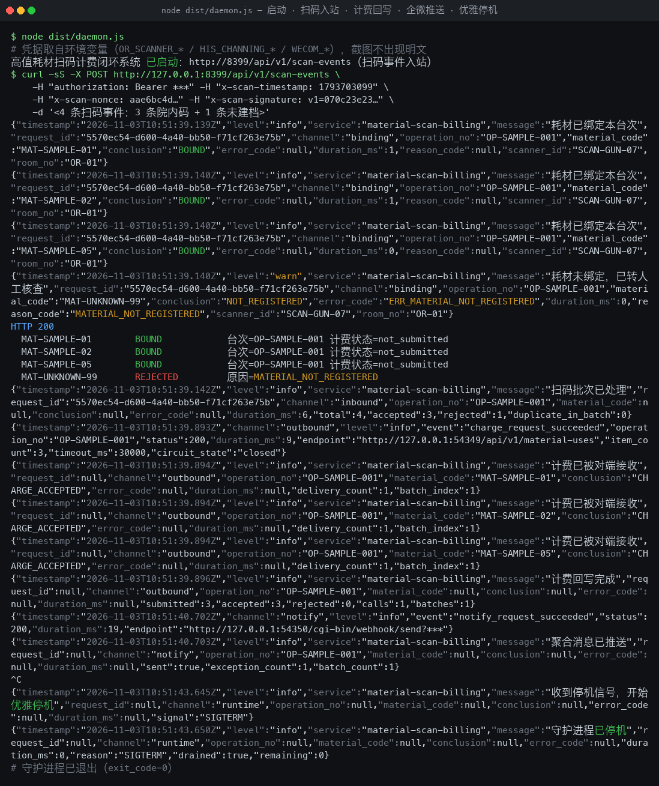
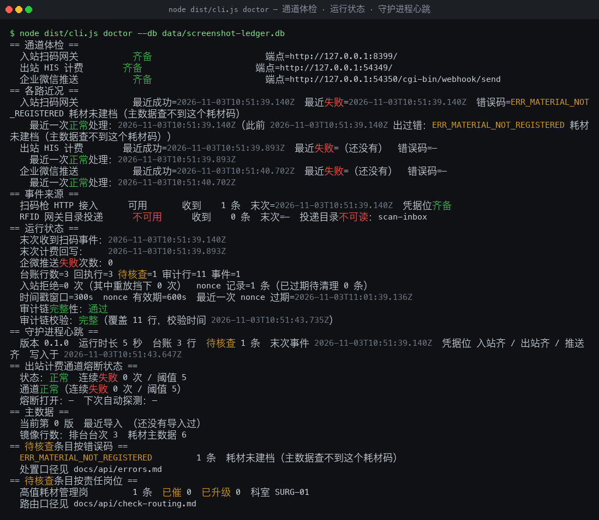
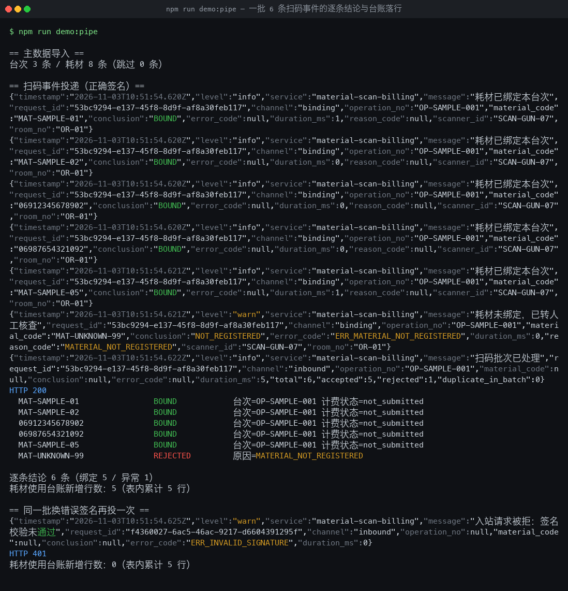
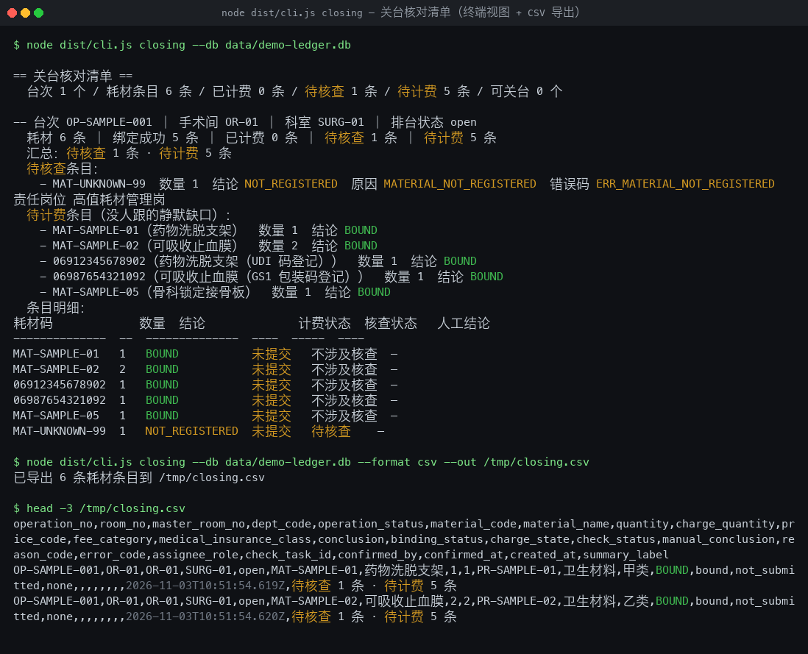

# 高值耗材扫码计费闭环系统

> 手术室扫码枪接入常驻守护进程，术中每扫一次高值耗材，当场拿到「这个码绑没绑上、计费生成了没有」的逐条结论；没绑上的直接变成带台次上下文的核查任务。

手术间扫码之后最耗人的是**回头核对**：这条码到底绑到哪台手术？计费侧生成了没有？漏在哪儿？
本系统把扫码枪事件接进一个常驻守护进程，**当场逐条给结论**——已绑定、耗材码未建档、与另一台次重复、台次已关台、计费被拒，五种结论一一落到台账；绑上的当场回写计费侧并取回执，没绑上的当场生成带台次上下文的核查任务并推到现有企业微信群，**不用另起一个 Excel 台账**。
**交付形态**：事件驱动守护进程（`npm start` 常驻运行）+ 运维 CLI（`node dist/cli.js <cmd>`），不是「跑一次出一张表」的报表脚本。

## 适用场景 / 目标岗位

| 岗位 | 什么时候用 | 得到什么 |
|------|------------|----------|
| 手术室器械护士 / 巡回护士 | 术中扫完一个高值耗材的那一刻 | 这一条的绑定结论 + 计费有没有生成，当场可见 |
| 手术室护士长 | 关台核对、签认台次耗材时 | 这一台还有哪几条没闭环、为什么没闭环、该找谁 |
| 收费员 | 关台后核收费单、排查漏计费 | 台账里有、计费侧没有的条目清单，逐条带归因 |
| 高值耗材管理岗 | 周 / 月度耗材对账 | 台次耗材使用明细 + 计费回执核对包，可导出 |
| 信息科接口工程师 | 设备接入、扫码枪不通、计费回写失败时 | 三路凭据位齐否、各路最近一次成功 / 失败时间与错误码 |

> 本表只写岗位口语与业务时刻；接口路径、请求字段、错误码等技术细节见「命令 / API / 配置说明」。

## 能力要点

- **扫一次就有一条结论**：一批 6 条扫码进来，逐条给出「已绑定 / 耗材码未建档 / 与另一台次重复 / 台次已关台 / 计费被拒」，一条被拒不丢同批其余条目。
- **扫到的码是哪种、坏在哪，一眼看清**：UDI（带批号 / 失效期）、GS1 包装码、院内自编码三种写法统一归一到同一条耗材主数据键；GTIN 校验位不符给独立原因码，不与「耗材未建档」混同（`docs/api/code-forms.md`）。
- **重复扫、重复投、重启续跑，都只计一次费**：幂等键由「耗材码 + 台次」派生（键档位可选 `v1` / `v2`），与时间戳、重试次数、扫码枪编号无关；崩溃重启后未完成的条目续跑，不产生第二笔计费（`docs/api/idempotency.md`）。
- **扫的是几包，计费算的是几支**：「1 包 = 5 支」这类包装 → 计价单位换算按主数据单位口径自动换；换不出来（除不尽、缺换算系数）一律转人工，不四舍五入、不静默取整（`docs/api/units.md`）。
- **费用类别与医保分类填错当场拦下**：耗材费用类别按院内 14 类费用口径逐条核（「卫生材料」是耗材唯一允许落地的类别），医保分类只能是甲 / 乙 / 丙类，错配判异常，不按错口径计费（`docs/api/fee-category.md`）。
- **计费失败不丢数据**：计费侧超时或 5xx 走指数退避重投，重投次数在回执里看得见；业务明确拒绝的直接转人工，不做无谓重试，也不静默丢弃。
- **异常条目自带台次上下文**：耗材码未建档、跨台次重复、台次已关台、归属冲突——每条异常都带着台次号、手术间、科室、扫码枪、数量、结论与原因码落到核查任务，按责任岗位自动路由；群里同一台次的异常在时间窗内合并成一条消息（默认 30 秒），重复扫码不重复推；**台账与计费两侧随时可对账、关台前有一份能签字的清单**：按「耗材码 + 台次」全外连接两侧，输出「台账有回执无 / 回执有台账无 / 两边字段不一致」三类差异；按台次聚合出「可关台 / 待核查 N 条」的核对清单，CSV / JSON / 终端三种形态导出。
- **全程只增不改的审计链 + 逐行可查的判定依据**：谁扫的、扫在哪台次、是否重复、回写时间与结果、推送成败链式哈希校验，改一行断一行立即暴露；637 条维度组合的预期结论、原因码与是否转人工全部列成表（`docs/api/judgement-matrix.md`），由脚本随代码生成。

## 快速开始

### 依赖
**Node.js ≥ 22.5.0**（本机验证 v26.4.0；需内置 `node:sqlite`、`node:http` 与原生 `fetch`）、**npm ≥ 10**、**零运行时依赖**（只需 `typescript` 与 `@types/node` 两个开发依赖）。

### 安装
```bash
cd material-scan-billing && npm install && npm run build
```

### 配置
**全部凭据只从环境变量读取**，不落配置文件、不硬编码；缺任一路凭据 → 该路拒绝启动并在日志中指名变量名（fail closed）。院内部署由 systemd `EnvironmentFile` / 容器 `env_file` 注入，本地开发直接 export 到进程环境。
```bash
export OR_SCANNER_BASE_URL="https://scanner-gw.hospital.internal" OR_SCANNER_TOKEN="<设备侧令牌>"
export OR_SCANNER_SECRET="<入站验签密钥>" HIS_CHARGING_BASE_URL="https://his-charging.hospital.internal"
export HIS_CHANGING_TOKEN="<计费侧令牌>" WECOM_WEBHOOK_URL="<企业微信机器人 webhook>"
export WECOM_SECRET="<企微签名密钥>"
```

### 构建与验证
```bash
npm run typecheck && npm run build   # 类型检查 + 编译
npm test                              # 跑全部测试（内置 node:test，无额外测试框架）
npm run demo:pipe                     # 一条命令跑通最窄端到端：验签 → 判定 → 落账 → 逐条回执
```

### 主命令速查
```bash
npm start                       # 启动常驻守护进程（扫码事件入站 + 目录投递监听）
node dist/cli.js doctor         # 三路凭据位齐否、各路可达性、最近成功/失败时间与错误码
node dist/cli.js closing        # 关台核对清单：按台次聚合未闭环条目，护士长签认的那一份
node dist/cli.js reconcile      # 台账 ↔ 计费回执逐条对账：哪些耗材没有生成计费
node dist/cli.js pack           # 导出核查包（含台次上下文、回执、人工结论，不含患者标识字段）
node dist/cli.js replay         # 区间重放 + 差异表 + 幂等不变式验证（默认连做两遍）
```

> 另有 `ledger`（台账查询导出）、`summary`（批次统计）、`attempts`（计费尝试史）、`events`（事件日志三向回查）、`import-master`（主数据导入）五个子命令，完整参数见 **[`docs/cli.md`](docs/cli.md)**。

## 命令 / API / 配置说明

### 关键配置项

| 配置项 | 默认值 | 方向 | 说明 |
|--------|--------|------|------|
| `OR_SCANNER_BASE_URL` | 空 | 读 | 扫码事件服务基址；入站路由挂在此基址的 `/api/v1/*` 前缀下 |
| `OR_SCANNER_TOKEN` | 空 | 读 | 入站 Bearer 令牌；与验签密钥**双重**校验；缺失则 HTTP 路拒绝启动 |
| `OR_SCANNER_SECRET` | 空 | 读 | 入站 HMAC-SHA256 密钥，签名串为 `{timestamp}.{nonce}.{raw_body}`；空密钥一律验签失败（不落台账） |
| `HIS_CHARGING_BASE_URL` | 空 | 写 | HIS 计费服务基址，出站请求打到 `{base}/api/v1/material-uses`；缺失则出站路拒绝启动 |
| `HIS_CHANGING_TOKEN` | 空 | 写 | 出站 Bearer 令牌；**仅在出站客户端盖章**，业务层与日志拿不到明文 |
| `HIS_CHARGING_TIMEOUT_MS` | `10000` | 写 | 出站**响应**超时基数（毫秒）；按本批条目数线性放大（有上限）→ 超时进退避重投 |
| `WECOM_WEBHOOK_URL` | 空 | 写 | 企业微信机器人 webhook，推送既有通道，不新造消息中心；缺失**不阻塞台账落库** |
| `IDEMPOTENCY_KEY_PROFILE` | `v1` | 读 | 幂等键档位：`v1` = 耗材码 + 台次；`v2` = 耗材码 + 台次 + 批号；取值非法 → 启动即报错并指名本变量名 |

> 完整配置项共 34 项（含 nonce 窗口与清理、出站端点路径、连接超时与连接池、熔断阈值与冷却、企微签名与聚合窗口、主数据 CSV 与编码策略、事件日志保留策略、监听端口等），逐项见 `.env.example`。

### CLI 子命令 / 接口端点

| 命令 | 用途 | 关键参数 |
|------|------|----------|
| `node dist/cli.js doctor` | 通道体检 | `--db`；三路凭据位齐否（**只报变量名，不报值**）、各路最近成功 / 失败时间与最近一个错误码、心跳、审计链完整性；`--probe` 加一次真探测，`--json` 输出机器可读体检单 |
| `node dist/cli.js ledger` | 台账查询与导出 | `--operation` / `--status` / `--material` / `--limit` / `--format table\|csv\|json` / `--out` |
| `node dist/cli.js pack` | 核查包导出（随包附审计链校验结论：是否完整 / 覆盖行数 / 校验时间 / 断点行号） | `--operation` / `--status` / `--limit` / `--format csv\|json` / `--out` |
| `node dist/cli.js closing` | 关台核对清单（**按台次聚合未闭环条目**，护士长签认的那一份） | `--operation` / `--operations` / `--from` / `--to` / `--format` / `--out`；口径见 `docs/api/closing-report.md` |
| `node dist/cli.js reconcile` | 台账 ↔ 计费回执逐条对账（**哪些耗材没有生成计费**） | `--operation` / `--material` / `--status` / `--dry-run`（只读盘点）/ `--create-check`（差异转核查任务）；口径见 `docs/api/reconcile.md` |
| `node dist/cli.js attempts` | 计费尝试史（**每次投递尝试一行**：时间 / attempt / 结果 / 错误码 / 通道可达性） | `--operation` / `--material` / `--from` / `--to` / `--format` / `--out`；口径见 `docs/api/charge-attempt-history.md` |
| `node dist/cli.js events` | 事件日志溯源（**设备到底报了什么 → 落了哪几行台账 → 怎么处置**） | `--request`（三向回查）/ `--material` / `--operation` / `--source`；口径见 `docs/api/event-log.md` |
| `node dist/cli.js replay` | 区间重放 + 差异表 + 幂等不变式验证 | `--limit` / `--operation` / `--batch` / `--from` / `--to` / `--source` / `--file` / `--charge` / `--no-verify` / `--diff-out` |
| `node dist/cli.js import-master` | 导入手术排台与耗材主数据（**导入即生效，不重启常驻进程**） | `--operations <排台台次.csv>` / `--materials <耗材主数据.csv>` / `--source`；口径见 `docs/api/master-data.md` |

常驻进程入口是 `node dist/daemon.js`（启动自检不通过即拒绝启动并指名变量名；`SIGTERM` / `SIGINT` 触发优雅停机，在途批次结算完再退，退出码 0）；容器与 systemd 判活用 `node dist/scripts/healthcheck.js --db <台账> --max-age <秒>`，心跳不新鲜即退出码 1。

**退出码**：`0` 成功 · `2` 参数错误（未知子命令 / 未知参数 / 参数取值不合法） · `3` 业务校验失败（台账库不存在 / 主数据读不到 / 幂等不变式不成立） · `4` 外部通道不可达（此时**不做任何重放，台账不动**） · `5` 内部错误。需要机器可读输出时加 `--json`（stdout 上只有一份 JSON，人话提示走 stderr）。

**入站响应体**（同批逐条给结论）：
```json
{
  "accepted": [ { "material_code": "MAT-SAMPLE-01", "operation_no": "OP-SAMPLE-001",
                  "bound": true, "conclusion": "BOUND", "charge_state": "not_submitted" } ],
  "rejected": [ { "material_code": "MAT-UNKNOWN-99", "reason_code": "MATERIAL_NOT_REGISTERED" } ]
}
```

### 错误与降级

| 场景 | 表现 | 处理方式 |
|------|------|----------|
| 入站签名不匹配 / 密钥为空 / 时间戳超窗 / 缺 nonce 头 | HTTP 401（`ERR_INVALID_SIGNATURE` / `ERR_STALE_TIMESTAMP` / `ERR_MISSING_NONCE`） | **不落台账**，记审计并返回错误码；同批条目不处理 |
| 同 nonce 在有效期内重复投递（抓包重放）/ 同码同台次重复投递 | HTTP 401（`ERR_REPLAY_NONCE_REPLAY`）或该条 `ERR_DUPLICATE_SCAN` | 前者**不落台账、不触发计费**，审计链留一行可查；后者幂等层已去重，**不产生第二行台账、不触发第二次计费** |
| 台次号不存在 / 已关台 / 手术间与科室对不上 / 耗材码未建档 / 已停用 / 同码已绑到另一台次 | 该条 `ERR_OPERATION_NOT_FOUND` / `ERR_OPERATION_CLOSED` / `ERR_OPERATION_CONFLICT` / `ERR_MATERIAL_NOT_REGISTERED` / `ERR_CROSS_OP_DUPLICATE` | 一律转核查任务；已关台的提示走人工补录、**不自动补录**；跨台次重复**先到者保留**，台账同时留两个台次号供核对 |
| 数量换算除不尽 / 缺换算系数 / 费用类别或医保分类错配 | 该条 `ERR_QUANTITY_NOT_DIVISIBLE` / `ERR_UNIT_RATIO_MISSING` / `ERR_FEE_CATEGORY_NOT_ALLOWED` | 判异常转人工，**不四舍五入、不按错口径计费**；缺口在导入期进主数据缺项清单，补录后重新导入自动销项 |
| 计费侧超时 / 5xx / 连不上 / 连续失败被熔断 | 回执 `CHANNEL_UNREACHABLE` + `ERR_CHARGE_TIMEOUT` / `ERR_CHARGE_HTTP_5XX` / `ERR_CHARGE_CIRCUIT_OPEN` | 指数退避重投，重投次数在回执可见；熔断期间**不再敲门**，条目留在重投队列、台账状态停在「待重投」，**不丢数据**；达上限转核查，不静默丢弃 |
| 计费业务拒绝 / 出站配置或字段不合法 / 响应结构不符 | `ERR_CHARGE_BUSINESS_REJECTED` / `ERR_CHARGE_CONFIG` / `ERR_CHARGE_RESPONSE_INVALID` | 业务拒绝按「可重投 / 不可重投 / 需人工」三档分流；配置或字段不合法**不发请求**并指名变量名或字段；响应结构不符按「通道不可达」重投，**不静默当成成功** |
| 企微推送失败 / 缺任一路凭据 | 主流程**不中断**；该路拒绝启动 | 推送失败计数写审计链，`doctor` 与 `summary` 可见；启动自检打印变量名并以非零码退出，其余路不受影响 |

> 每个错误码的完整口径（中文含义、值不值得重投、建议处置、排查顺序）见 **[`docs/api/errors.md`](docs/api/errors.md)**；结构化日志、核查条目、计费回执行展示的是**同一个码**，`doctor` 会把待核查条目按错误码分组列出。

### 对接现有系统

| 对端 | 方向 | 协议与端点 | 凭据来源 | 校验方式 |
|------|------|------------|----------|----------|
| 手术室扫码枪 / 扫码网关 | 入站（读事件） | HTTP + JSON，`POST /api/v1/scan-events` | `$OR_SCANNER_TOKEN` + `$OR_SCANNER_SECRET` | Bearer + HMAC-SHA256 over `{timestamp}.{nonce}.{raw_body}`，常量时间比较；三层重放防护（时间戳窗口 / nonce 去重 / 幂等键），详见 `docs/api/scan-event.md` |
| RFID 网关 | 入站（读事件） | 目录投递 `scan-inbox/<operation_no>/<batch>.jsonl` | 无（本地目录） | 与 HTTP 路共用解析层与幂等键，单行坏数据只让该行失败 |
| HIS 耗材计费 | 出站（写明细） | HTTP + JSON，`POST {HIS_CHARGING_BASE_URL}/api/v1/material-uses` | `$HIS_CHARGING_TOKEN` | 请求 / 响应字段契约逐字段断言，幂等键一并透传给对端去重，字段规范落盘 `docs/api/his-charging.md` |
| 企业微信机器人 | 出站（推送） | HTTP + JSON webhook（加签 `sha1("{timestamp}{secret}{key}")`） | `$WECOM_WEBHOOK_URL` + `$WECOM_SECRET` | 按台次聚合 + 异常唯一键去重 + 窗口键去重，无异常批次默认不推；字段规范落盘 `docs/api/wecom-notify.md` |

**凭据位一律从环境变量读取**，不写死在代码或配置文件里；出站 Bearer **只在出站客户端盖章**，业务层取不到明文，日志与异常信息一律打码；**脱敏替身只出现在测试数据层**——测试用的计费替身与生产客户端走**同一条 HTTP 客户端代码路径**，默认启动路径永不指向 localhost。

## 典型场景

### 场景 1：手术室器械护士术中扫码，当场看结论
扫码枪把一批 6 条耗材扫码投递给守护进程 → 守护进程逐条给结论：绑上的当场回写计费侧并取回执，没绑上的当场生成核查任务并推企微 → 护士看到「这一批 accepted=5 rejected=1」，以及每条没绑上的原因与该谁处理。
```bash
npm start                                            # 启动常驻守护进程
node dist/cli.js ledger --operation OP-SAMPLE-001   # 另一终端：查看本批逐条结论与台账
```

### 场景 2：护士长关台核对，导出一份能签字的清单
关台前导出关台核对清单，按台次聚合全部耗材条目 → 清单标注「可关台」还是「待核查 N 条」，逐条列出待核查项的原因码与建议处置 → 护士长签认，需要人工补录的条目在核查任务上落结论后回写台账。
```bash
node dist/cli.js closing --operation OP-SAMPLE-001 --format csv --out closing-OP-SAMPLE-001.csv
node dist/cli.js closing --from 2026-01-01T00:00:00Z --to 2026-01-08T00:00:00Z --format csv  # 周度批量核对
```

### 场景 3：收费员核收费单，找出漏计费的条目
跑台账 ↔ 计费回执对账，按「耗材码 + 台次」全外连接两侧 → 输出三类差异（台账有回执无、回执有台账无、两边字段不一致），每条给出归因与建议处置 → 差异可直接转成核查任务，交护士长或耗材管理岗处置。
```bash
node dist/cli.js reconcile --format table               # 打印差异台账
node dist/cli.js reconcile --create-check               # 差异转核查任务
```

### 场景 4：信息科排查「扫码枪不通 / 计费回写失败」
跑 `doctor`，先看三路凭据位齐否、各路最近一次成功与失败时间、熔断状态、主数据版本 → 按错误码表定位（日志、核查条目、回执展示同一个错误码）→ 通道不可达时条目仍在退避重投队列里，不会被静默丢掉。
```bash
node dist/cli.js doctor --probe                        # 主动探测：此刻到底通不通
node dist/cli.js replay --limit 50                     # 重放事件日志，验证重复投递不产生第二笔计费
```

### 场景 5：耗材管理岗月度对账，导出对账包
用全量院内数据跑完主路径，按「科室 × 业务月」聚合出高值耗材月度对账包（汇总表 + 明细表 + 下钻索引）→ 抽样回查台账与计费回执逐条一致 → 主数据缺项（单位系数、费用类别、医保分类）随包列出，补录后重新导入自动销项。
```bash
npm run monthly:run -- --from 2026-01 --to 2026-03 --out-dir data/monthly
```

## 输出样例

完整样例（入站报文、回执、核查条目、清单、对账包、审计链行）见 **[`docs/examples.md`](docs/examples.md)**。以下为脱敏片段。

### 终端逐条回执
```
HTTP 200
  MAT-SAMPLE-01                BOUND            台次=OP-SAMPLE-001 计费状态=not_submitted
  MAT-SAMPLE-02                BOUND            台次=OP-SAMPLE-001 计费状态=not_submitted
  06912345678902               BOUND            台次=OP-SAMPLE-001 计费状态=not_submitted
  06987654321092               BOUND            台次=OP-SAMPLE-001 计费状态=not_submitted
  MAT-SAMPLE-05                BOUND            台次=OP-SAMPLE-001 计费状态=not_submitted
  MAT-UNKNOWN-99               REJECTED         原因=MATERIAL_NOT_REGISTERED

逐条结论 6 条（绑定 5 / 异常 1）
耗材使用台账新增行数：5（表内累计 5 行）
```

### 台账导出（CSV 片段）
```csv
operation_no,room_no,dept_code,material_code,quantity,price_code,fee_category,medical_insurance_class,conclusion,status,check_task_id,charge_state,created_at
OP-SAMPLE-001,OR-01,SURG-01,MAT-SAMPLE-01,1,PR-SAMPLE-01,卫生材料,甲类,BOUND,bound,,not_submitted,2026-11-03T12:29:14.421Z
OP-SAMPLE-001,OR-01,SURG-01,06912345678902,1,PR-DEMO-UDI,卫生材料,甲类,BOUND,bound,,not_submitted,2026-11-03T12:29:14.422Z
```

### 关台核对清单（终端视图）
```
== 关台核对清单 ==
  台次 1 个 / 耗材条目 6 条 / 已计费 0 条 / 待核查 1 条 / 待计费 5 条 / 可关台 0 个

-- 台次 OP-SAMPLE-001 ｜ 手术间 OR-01 ｜ 科室 SURG-01 ｜ 排台状态 open
  汇总：待核查 1 条 · 待计费 5 条
  待核查条目：
    - MAT-UNKNOWN-99　数量 1　结论 NOT_REGISTERED　原因 MATERIAL_NOT_REGISTERED　错误码 ERR_MATERIAL_NOT_REGISTERED　责任岗位 高值耗材管理岗
```

## 概念 / 实测对照

### 视觉目标
结构化视觉目标卡见 **[`docs/concepts/visual-target.md`](docs/concepts/visual-target.md)**。要点：画面是**终端服务日志 + 既有通道推送消息**，不是浏览器控制台。
- **起始态**：只有几行启动自检（监听端口、适配器就绪、各路凭据位齐否），没有任何耗材事件。
- **首个可用瞬间**：一批 6 条扫码逐条打出回执行，紧跟一行批次汇总（`accepted=5 rejected=1`），异常批次同时在企业微信群落下摘要。
- **成形态**：进程安静下来，只在有事件时输出；台账可按台次或耗材码回查整批流水与每条回执。

> 本环境无图像生成能力，故只保留结构化视觉目标卡，**未放置任何占位图或伪造图片**。

### 实测证据
下列四张图全部来自**本机真实运行的命令输出**（逐字来自 stdout / stderr，无改写、无补画），按终端样式渲染成 PNG。









| 图 | 命令 | 真实产出 |
|----|------|----------|
| ①② | `node dist/daemon.js`（配齐三路凭据）→ 用真签名 POST 一批 4 条扫码 → `SIGTERM`；`node dist/cli.js doctor --db data/screenshot-ledger.db` | 3 条绑上、1 条转人工；出站计费 1 次 / 3 条明细，对端重复计费 0 条；企微聚合窗口内 1 条消息；停机 `drained=true`、`exit_code=0`；三路凭据位齐备，心跳行含版本 / 运行时长 / 台账行数 / 待核查数 / 末次事件时间 |
| ③ | `npm run demo:pipe` | 6 条逐条结论（绑定 5 / 异常 1）、台账新增 5 行；同批换错误签名再投 → HTTP 401 且新增 0 行 |
| ④ | `node dist/cli.js closing --db data/demo-ledger.db`（含 `--format csv --out`） | 待核查 1 条 · 待计费 5 条，CSV 表头 25 列与字段白名单逐字一致 |

> **诚实标注（差距在哪）**
>
> - 上半部分是**视觉目标**（`docs/concepts/visual-target.md`，设计意图）；下半部分是**实测证据**（`docs/screenshots/`，真实运行）。**目标卡描述的看板大屏并不存在** —— 本产品是常驻守护进程，可见产物就是逐条回执行、企微消息与可导出台账；目标卡里的「成形态」画面比实际更漂亮，实际实现不会为了好看而多打一行字。
> - 图片是**真实命令输出按终端样式渲染**的结果：文字逐字来自 stdout / stderr，颜色只按关键词（`BOUND` / `warn` / `REJECTED` 等）着色，**没有改写内容，也没有生成任何「事后效果图」来抹平差距**；采集环境里**出站 HIS 计费与企微推送由本机的真实 HTTP 服务承接**（院内系统在本环境不可达），产品代码走的是同一条原生 `fetch` → 真实 socket → 真实请求头与请求体的路径，截图里的 `127.0.0.1:<端口>` 端点就是这个承接端点，**不是**最终对接地址（真实对接形态见 [`docs/api/his-charging.md`](docs/api/his-charging.md)）。截图中**不含任何凭据明文**：令牌与密钥取自环境变量，命令行里的 `Bearer ***` 与被截断的签名是采集时主动脱敏的。

## 架构与数据流

```
   扫码枪 HTTP 接入              RFID 网关目录投递
   POST /api/v1/scan-events     scan-inbox/<台次>/<批次>.jsonl
          │ Bearer + HMAC 签名        │ 文件轮询
          └────────────┬───────────────┘
                       ▼
  ┌─────────────────────────────────────────────────────────────┐
  │ ① 验签 + 三层重放防护（时间戳 / nonce / 幂等键）→ 不过 401，不落台账 │
  │ ② 字段标准化 UDI / GS1 AI(01) / 院内码 → 规范耗材码（含 GTIN 校验位）  │
  │ ③ 幂等占位 claim / confirm / release（键 = sha256(档位|耗材码|台次[|批号])）│
  │ ④ 绑定判定引擎：三层校验 → 台次状态 → 归属双因子 → 单位口径 → 数量换算 → │
  │    跨台次重复 → 五种结论（重复投递 → DUPLICATE_SCAN）                   │
  └──────────┬──────────────────────────────┬─────────────────────┘
     BOUND    │                              │ 异常结论
              ▼                              ▼
  ┌───────────────────────┐  ┌───────────────────────────────┐
  │ ⑤ 耗材使用台账落行      │  │ ⑤′ 核查条目（带台次上下文）      │
  │  material_binding      │  │  check_task（责任路由 + 升级）    │
  │  + audit_chain（哈希链）│  └─────────────┬──────────────────┘
  └───────────┬───────────┘                │
              ▼                            │ ⑥ 出站计费回写
   POST {HIS}/api/v1/material-uses（Bearer 单一出口盖章 · 幂等键透传给对端）
              ▼
  ┌─────────────────────────────────────────────────────────────┐
  │ ⑦ 逐条回执归类 + 指数退避重投（charge_receipt，每次 attempt 一行）    │
  │    通道不可达 → 重投；业务拒绝 → 直接转人工                          │
  │ ⑧ 批次摘要推送（企业微信机器人，按台次聚合）· 失败不阻塞台账落库        │
  └─────────────────────────────────────────────────────────────┘
```

> 全程留痕：`scan_event`（原始报文 + 归一结果）→ `material_binding`（台账）→ `charge_receipt`（回执）→ `check_task`（核查）→ `audit_chain`（哈希链，只增不改）。状态机、幂等键三档、表结构与索引、事务边界见 **[`docs/architecture.md`](docs/architecture.md)**。

### 关键不变量

- **幂等键与时间无关**：键由「档位 + 耗材码 + 台次（v2 档位再加批号）」派生，与时间戳、重试次数、扫码枪编号无关；同一把键在重投时逐字复用。
- **单条失败不中断同批**：一批里任何一条抛错，只让该条落入拒绝并给原因码，其余条目照常给结论、照常回写计费。
- **绝不猜绑**：台次、手术间、科室、主数据任一存在歧义，结果必须落在异常结论，不允许落到「已绑定」。
- **已回写计费不自动冲正**：条目一旦计费成功，不会自动退回或改写；撤回核查任务只回退台账状态，冲正属人工处置。
- **失败不静默改数据**：计费不可达走退避重投并把台账状态停在「待重投」；推送失败只计数不抛错；任何写入失败要么同事务回滚，要么显式记审计；**凭据不落明文、患者标识不进台账**：出站 Bearer 只在出站客户端盖章，日志、异常、导出全链路打码；耗材码只绑到手术台次，导出与核查包不含患者可识别明细。

## 安全与合规边界

- 耗材码只绑定**手术台次**，**不落患者可识别明细**；核查包与对账导出的字段白名单里不含患者标识字段。
- 本产品**不产生任何临床文书**，不输出诊断或治疗建议，不做自动签名或代签；术中增减 / 替换 / 退库的**冲正与差额不在本轮范围**（本轮只做正向新增计费，冲正由人工处置）。 出站凭据仅在出站客户端盖章，审计链只增不改并可校验完整性，供内审与飞检语境核对。

## 验收与自检

| 验收项 | 命令 | 期望结果 |
|--------|------|----------|
| 编译通过 | `npm run build` | 无错误，`dist/` 产出 `daemon.js` 与 `cli.js` |
| 全部测试 | `npm test` | 全部用例通过 |
| 最窄端到端可跑通 | `npm run demo:pipe` | 打印 6 条逐条结论行 + 台账新增行数 |
| 同键重复投递不重复计费 / 并发同键串行化 | `node --test dist/tests/claim.test.js` / `dist/tests/concurrency.test.js` | 同键投递 10 次台账仅 1 行、计费仅 1 次；并发 20 次同键：台账 1 行、计费 1 次、busy 19 次 |
| 错误签名不落台账 | `node --test dist/tests/http-ingest.test.js` | 401 且台账行数不变 |
| 入站重放防护三层 | `node --test dist/tests/replay-guard.test.js` | 过期时间戳 401 不落台账；同 nonce 二次投递 401；改戳重算签名仍被 nonce 拦下；换 nonce 改戳可入但幂等键拦下（不产生第二行台账） |
| 单条失败不丢同批 | `node --test dist/tests/settle.test.js` | 注入 1 条异常后 accepted=5 / rejected=1 |
| 审计链哈希链 | `node --test dist/tests/audit-chain.test.js` | 追加 100 行校验 intact；改动或删除即断链并指出断点行号；库内 UPDATE / DELETE 被触发器拒绝 |
| 台账 ↔ 回执对账 / 计费尝试史 | `node --test dist/tests/reconcile.test.js` / `dist/tests/receipt-history.test.js` | 三类差异分类与归因正确；每次尝试一行、序号连续、导出字段白名单无患者标识 |
| 区间重放 + 幂等不变式 | `node --test dist/tests/replay.test.js` | 同一区间连续重放两次：第二次台账行数增量 = 0、计费调用增量 = 0、对端重复计费 0 条 |
| 判定边界矩阵 | `node --test dist/tests/boundary-matrix.test.js` | 637 条用例逐条断言：结论、原因码、是否需人工与预期矩阵逐字一致；绝不猜绑负例全绿 |
| 数量换算与费用口径 | `node --test dist/tests/units.test.js` / `dist/tests/fee-category.test.js` | 1 包 = 5 支换算为 5 且除不尽不四舍五入；14 类允许集顺序与院内口径逐字一致，错配各给独立原因码 |
| 主数据热更新（导入即生效） | `node --test dist/tests/master-data-live.test.js` | 改完主数据无需重启即按新值判定；停用耗材不再被绑定；版本号随导入递增且 doctor 可见 |
| CLI 参数与退出码契约 | `node --test dist/tests/cli-contract.test.js` | 子命令 `--help` 四要素齐全；非法参数退出码 2；台账库不存在退出码 3；出站通道不可达退出码 4 且不动台账；输出不含凭据明文 |
| 事件日志三向回查 / 月度对账 | `node --test dist/tests/event-log.test.js` / `dist/tests/monthly.test.js` | 按投递标识 / 耗材码 / 台次三路回查条数一致；账期按业务使用时间与东八区切分，导出不含患者标识字段 |
| 200 并发 / 1000 条规模跑测与对照基线 | `npm run bench:concurrency` / `npm run bench:idempotency` | 幂等版恒定：台账 1 行 / 计费 1 次 / 对端 0 条重复计费；朴素基线台账多行、对端重复计费 > 0（1000 条批次 30 条）；结论落盘 `docs/benchmarks/` 下两份对照文档 |
| 月度对账跑测（全量合成数据） | `npm run monthly:run` | 1200 台次 / 5200 耗材 / 2352 批 / 15282 条扫码走完主路径：结论正确率 100%、对端重复计费 0 条；结论落盘 `docs/benchmarks/monthly-reconcile.md` |

> 上表「全部测试」跑全套；其余 `node --test dist/tests/<file>.test.js` 需先 `npm run build`（编译产物在 `dist/`）。

## 项目结构

```
material-scan-billing/
├── src/
│   ├── config/ domain/     # 凭据位解析与扫码枪台账登记 / 领域模型与不变量（幂等键派生、8×8 状态迁移表、字段校验）
│   ├── ingest/ engine/     # 接入层（HMAC 验签、nonce 去重、码制归一、两路事件源）/ ★ 核心判定引擎（三层校验、五种结论、数量换算、费用口径）
│   ├── charge/ check/      # 出站计费层（Bearer 单一出口、限批切分、熔断、退避重投、尝试史）/ 核查与推送（核查任务、人工确认回写、企微聚合、关台清单）
│   ├── ledger/ data/       # 存储层（WAL、迁移版本链、租约占位、三类差异对账、哈希审计链、主数据热更新）/ 数据获取与合成层（公开数据拉取 + 确定性合成）
│   ├── log/ health/ api/   # 结构化日志与统一错误码表 / 通道主动探测 / 入站出站字段级契约
│   ├── daemon/ cli/        # 常驻守护进程（心跳、启动自检、优雅停机）/ 运维命令行（分派、退出码、凭据打码、区间重放）
├── scripts/                # 跑测与数据脚本：最窄端到端演示、规模跑测、朴素基线、并发压测、月度对账、三份矩阵文档生成、公开数据与合成数据三件套、心跳探针
├── tests/                  # node:test 用例（46 个 *.test.ts）+ fixtures/（单测边界样例）+ boundary/（637 条判定矩阵）+ support/（真实 HTTP 计费替身）
├── docs/                   # architecture.md / cli.md / examples.md + api/（20 份字段规范与错误码口径）+ benchmarks/（三份对照与跑测结论）+ concepts/（视觉目标卡）+ screenshots/（真实运行截图）
├── deploy/                 # systemd unit（Restart=always + EnvironmentFile）/ docker-compose.yml（状态卷 + env_file + healthcheck）
├── data/                   # 运行目录：SQLite 台账 + 验证数据产物（gitignore；npm run data:prepare 可重跑）
├── daemon.ts / cli.ts      # 常驻守护进程入口 → dist/daemon.js / 运维命令行入口 → dist/cli.js
├── Dockerfile              # Node 22 slim 镜像，非 root 运行，HEALTHCHECK 走心跳探针
├── .env.example            # 凭据位样例（值留空）+ 全部可调参数 ├── package.json            # 工程定义：零运行时依赖
├── tsconfig.json           # 编译配置（ES2023 / nodenext / strict）
├── .gitignore              # 排除 .env / node_modules / dist / data / logs / 各类缓存
└── README.md               # 本文件
```

---

## License

MIT

---

## 关注我们

欢迎扫码关注公众号，获取项目更新与交流加群：

