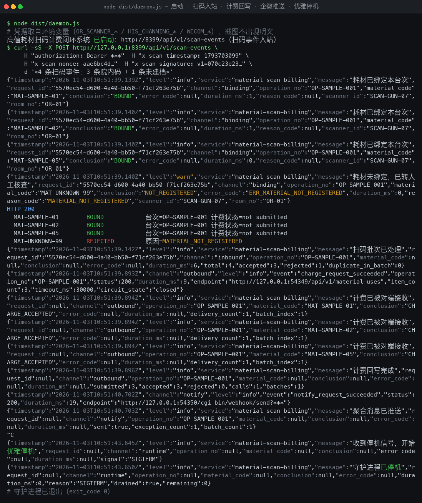
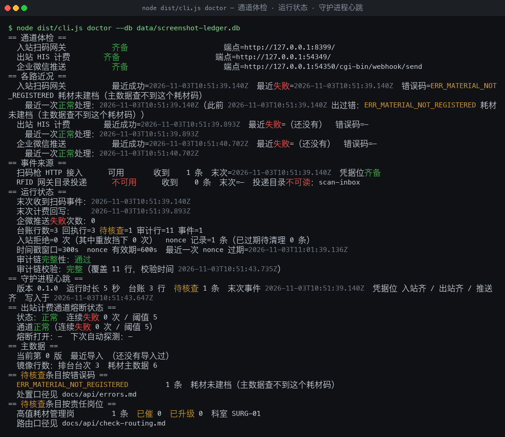
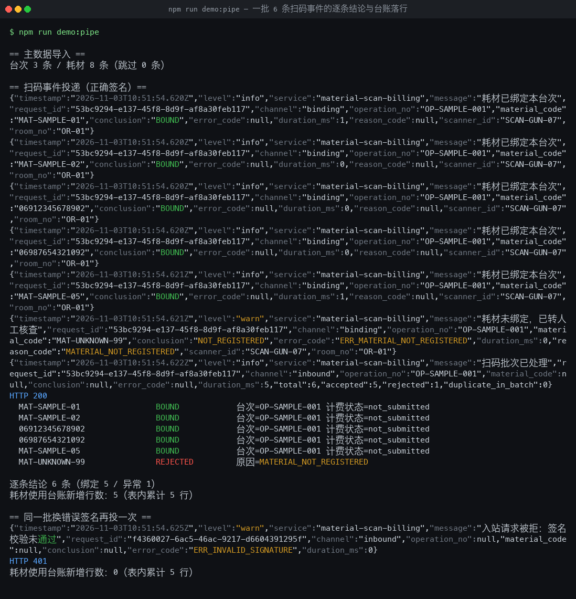
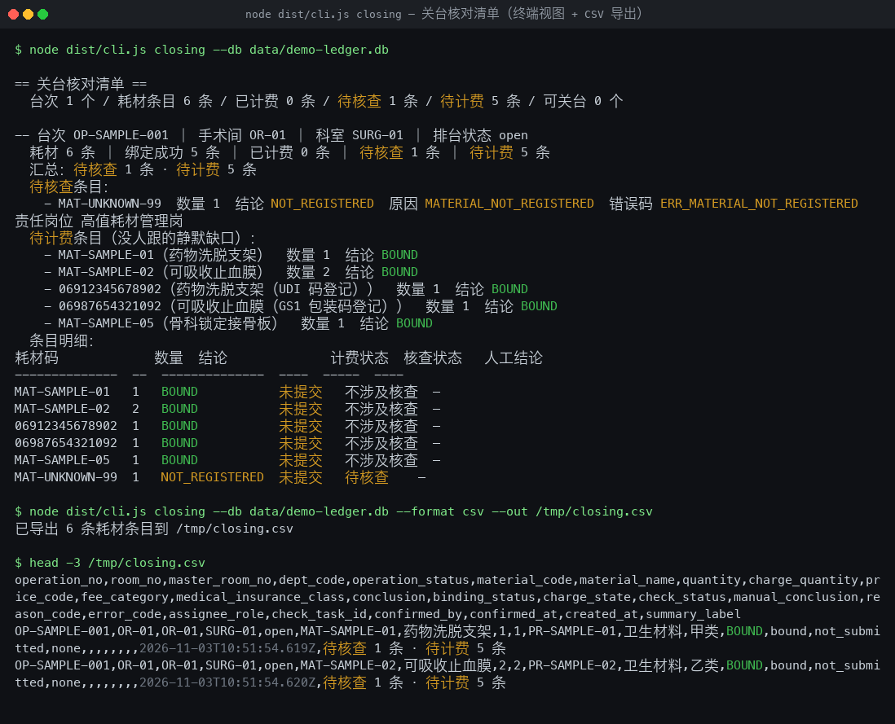

# High-Value Consumable Scan-to-Charge Closed-Loop System

> The operating-room scanner feeds a resident daemon; with every high-value consumable scanned during surgery, you immediately get a per-item verdict on "did this code bind, and was a charge generated?" — anything that did not bind turns into a check task carrying the operation context.

The most exhausting part of scanning in the operating room is the **looking back afterwards**: which operation did this code actually bind to? Was a charge generated on the charging side? Where exactly was it dropped?
This system pipes scanner events into a resident daemon and **gives a verdict on the spot, item by item** — bound, consumable code not registered, duplicate of another operation, operation already closed, charge rejected — all five conclusions land in the ledger; bound items are written back to the charging side and the receipt is fetched immediately, unbound items become check tasks with operation context and are pushed to the existing WeCom (WeChat Work) group, **without starting yet another Excel ledger**.
**Delivery form**: an event-driven resident daemon (`npm start`, runs continuously) plus an ops CLI (`node dist/cli.js <cmd>`) — not a "run once and print a table" report script.

## Use Cases / Target Roles

| Role | When they use it | What they get |
|------|------------|----------|
| Operating-room instrument nurse / circulating nurse | The moment a high-value consumable is scanned during surgery | The binding verdict for that item, plus whether a charge was generated — visible on the spot |
| Operating-room head nurse | At case closure, when signing off the case's consumables | Which items of this case are still not closed, why they are not closed, and who to chase |
| Cashier | After case closure, checking the charge sheet and hunting missed charges | A list of items present in the ledger but absent on the charging side, each with attribution |
| High-value consumable steward | Weekly / monthly consumable reconciliation | Per-operation consumable usage detail plus a charge-receipt reconciliation pack, exportable |
| Hospital IT interface engineer | During device onboarding, when the scanner does not connect, or when charge write-back fails | Whether all three credential slots are present, and each channel's last success / failure time and error code |

> This table only states role vernacular and business moments; technical details such as endpoint paths, request fields and error codes are in "Commands / API / Configuration".

## Capabilities

- **One scan, one verdict**: when a batch of 6 scans arrives, each item gets "bound / consumable code not registered / duplicate of another operation / operation already closed / charge rejected" — a rejected item never swallows the rest of the batch.
- **You can see at a glance which kind of code was scanned and where it broke**: UDI (with lot number / expiry), GS1 packaging codes and in-house codes are normalized onto one consumable master-data key; a mismatched GTIN check digit gets its own reason code and is never conflated with "consumable not registered" (`docs/api/code-forms.md`).
- **Repeat scans, repeat submissions and restarts are charged only once**: the idempotency key is derived from "consumable code + operation" (key profile selectable as `v1` / `v2`) and is independent of timestamps, retry counts and scanner IDs; unfinished items resume after a crash restart without producing a second charge (`docs/api/idempotency.md`).
- **You scanned N packages; the charge counts N units**: packaging ratios such as "1 pack = 5 units" are converted automatically per the master-data unit definition; when conversion is impossible (not divisible, missing ratio coefficient) the item always goes to manual handling — never rounded, never silently truncated (`docs/api/units.md`).
- **Wrong fee category or medical-insurance class is blocked on the spot**: consumable fee categories are checked item by item against the hospital's 14 fee categories ("health materials" is the only category consumables may land in); the medical-insurance class may only be Class A / B / C, a mismatch is judged an anomaly, and no charge is billed under a wrong definition (`docs/api/fee-category.md`).
- **Failed charges never lose data**: timeouts or 5xx on the charging side go into exponential-backoff resubmission, and the retry count is visible in the receipt; explicit business rejections go straight to manual handling — no pointless retries, and nothing is silently dropped.
- **Anomalous items carry operation context**: consumable code not registered, cross-operation duplicate, operation already closed, ownership conflict — every anomaly lands on a check task with the operation number, operating room, department, scanner, quantity, conclusion and reason code, routed to the responsible role; anomalies of the same operation inside the time window are merged into a single group message (30 seconds by default), and repeat scans do not trigger a repeat push; **the ledger and the charging side can be reconciled at any time, and before case closure there is a signable checklist**: a full outer join on "consumable code + operation" produces three classes of difference — "in ledger but no receipt / receipt but not in ledger / field mismatch on both sides"; aggregating by operation yields a "ready to close / N items pending check" checklist, exportable as CSV / JSON / terminal output.
- **An append-only audit chain plus per-line judgement rationale**: who scanned, on which operation, whether it was a duplicate, when the write-back happened and with what result, and a chained hash over push success — changing one line breaks the chain and exposes it immediately; the expected conclusion, reason code and manual-handling flag for all 637 dimension combinations are tabulated (`docs/api/judgement-matrix.md`) and generated by a script alongside the code.

## Quick Start

### Requirements
**Node.js ≥ 22.5.0** (verified locally on v26.4.0; requires built-in `node:sqlite`, `node:http` and native `fetch`), **npm ≥ 10**, **zero runtime dependencies** (only two dev dependencies: `typescript` and `@types/node`).

### Install
```bash
cd material-scan-billing && npm install && npm run build
```

### Configure
**All credentials are read from environment variables only** — never written to config files, never hardcoded; if any channel's credential is missing, that channel refuses to start and the log names the variable (fail closed). In-hospital deployment injects them via systemd `EnvironmentFile` / container `env_file`; local development just exports them into the process environment.
```bash
export OR_SCANNER_BASE_URL="https://scanner-gw.hospital.internal" OR_SCANNER_TOKEN="<device-side token>"
export OR_SCANNER_SECRET="<inbound signature secret>" HIS_CHARGING_BASE_URL="https://his-charging.hospital.internal"
export HIS_CHANGING_TOKEN="<charging-side token>" WECOM_WEBHOOK_URL="<WeCom robot webhook>"
export WECOM_SECRET="<WeCom signature secret>"
```

### Build and Verify
```bash
npm run typecheck && npm run build   # type check + compile
npm test                              # run all tests (built-in node:test, no extra test framework)
npm run demo:pipe                     # one command runs the narrowest end-to-end path: verify → judge → ledger → per-item receipts
```

### Main Command Reference
```bash
npm start                       # start the resident daemon (inbound scan events + directory delivery listener)
node dist/cli.js doctor         # whether all three credential slots are present, channel reachability, last success/failure time and error codes
node dist/cli.js closing        # case-closure checklist: aggregate unclosed items per operation — the one the head nurse signs
node dist/cli.js reconcile      # ledger ↔ charge receipt reconciliation, item by item: which consumables produced no charge
node dist/cli.js pack           # export the check pack (operation context, receipts, manual conclusions; no patient identifier fields)
node dist/cli.js replay         # range replay + diff table + idempotency invariant verification (runs twice by default)
```

> Five further subcommands exist — `ledger` (ledger query and export), `summary` (batch statistics), `attempts` (charge attempt history), `events` (three-way back-trace of the event log), `import-master` (master data import); see **[`docs/cli.md`](docs/cli.md)** for the full parameters.

## Commands / API / Configuration

### Key Configuration Items

| Variable | Default | Direction | Description |
|--------|--------|------|------|
| `OR_SCANNER_BASE_URL` | empty | read | Base URL of the scan-event service; the inbound route is mounted under the `/api/v1/*` prefix of this base URL |
| `OR_SCANNER_TOKEN` | empty | read | Inbound Bearer token; checked **together with** the signature secret; the HTTP channel refuses to start if missing |
| `OR_SCANNER_SECRET` | empty | read | Inbound HMAC-SHA256 secret; the signed string is `{timestamp}.{nonce}.{raw_body}`; an empty secret always fails verification (nothing is written to the ledger) |
| `HIS_CHARGING_BASE_URL` | empty | write | Base URL of the HIS charging service; outbound requests go to `{base}/api/v1/material-uses`; the outbound channel refuses to start if missing |
| `HIS_CHANGING_TOKEN` | empty | write | Outbound Bearer token; **stamped only in the outbound client**, never readable from the business layer or the logs |
| `HIS_CHARGING_TIMEOUT_MS` | `10000` | write | Base outbound **response** timeout in milliseconds; scaled linearly by the number of items in the batch (with a cap) → a timeout enters backoff resubmission |
| `WECOM_WEBHOOK_URL` | empty | write | WeCom robot webhook; pushes through the existing channel instead of inventing a message center; if missing it **does not block ledger writes** |
| `IDEMPOTENCY_KEY_PROFILE` | `v1` | read | Idempotency key profile: `v1` = consumable code + operation; `v2` = consumable code + operation + lot number; an illegal value → the process errors out at startup and names this variable |

> There are 34 configuration items in total (nonce window and cleanup, outbound endpoint paths, connect timeout and connection pool, circuit-breaker thresholds and cooldown, WeCom signing and aggregation window, master-data CSV and encoding policy, event-log retention policy, listening port, etc.); see `.env.example` for every one of them.

### CLI Subcommands / API Endpoints

| Command | Purpose | Key parameters |
|------|------|----------|
| `node dist/cli.js doctor` | Channel health check | `--db`; whether all three credential slots are present (**variable names only, never values**), each channel's last success / failure time and most recent error code, heartbeat, audit-chain integrity; `--probe` adds a real probe, `--json` emits a machine-readable health report |
| `node dist/cli.js ledger` | Ledger query and export | `--operation` / `--status` / `--material` / `--limit` / `--format table\|csv\|json` / `--out` |
| `node dist/cli.js pack` | Check-pack export (the pack carries the audit-chain verdict: complete or not / covered row count / verification time / break line number) | `--operation` / `--status` / `--limit` / `--format csv\|json` / `--out` |
| `node dist/cli.js closing` | Case-closure checklist (**aggregates unclosed items per operation** — the one the head nurse signs) | `--operation` / `--operations` / `--from` / `--to` / `--format` / `--out`; definition in `docs/api/closing-report.md` |
| `node dist/cli.js reconcile` | Ledger ↔ charge receipt reconciliation, item by item (**which consumables produced no charge**) | `--operation` / `--material` / `--status` / `--dry-run` (read-only inventory) / `--create-check` (convert differences into check tasks); definition in `docs/api/reconcile.md` |
| `node dist/cli.js attempts` | Charge attempt history (**one row per delivery attempt**: time / attempt / result / error code / channel reachability) | `--operation` / `--material` / `--from` / `--to` / `--format` / `--out`; definition in `docs/api/charge-attempt-history.md` |
| `node dist/cli.js events` | Event-log tracing (**what the device actually reported → which ledger rows it produced → how it was handled**) | `--request` (three-way back-trace) / `--material` / `--operation` / `--source`; definition in `docs/api/event-log.md` |
| `node dist/cli.js replay` | Range replay + diff table + idempotency invariant verification | `--limit` / `--operation` / `--batch` / `--from` / `--to` / `--source` / `--file` / `--charge` / `--no-verify` / `--diff-out` |
| `node dist/cli.js import-master` | Import the surgery schedule and consumable master data (**takes effect on import, no daemon restart**) | `--operations <schedule-operations.csv>` / `--materials <consumable-master.csv>` / `--source`; definition in `docs/api/master-data.md` |

The resident process entry point is `node dist/daemon.js` (it refuses to start when the startup self-check fails and names the variable; `SIGTERM` / `SIGINT` trigger a graceful shutdown — in-flight batches are drained before exit, exit code 0); containers and systemd use `node dist/scripts/healthcheck.js --db <ledger> --max-age <seconds>` for liveness, and the process exits with code 1 when the heartbeat is stale.

**Exit codes**: `0` success · `2` argument error (unknown subcommand / unknown argument / illegal argument value) · `3` business validation failure (ledger store missing / master data unreadable / idempotency invariant does not hold) · `4` external channel unreachable (**no replay is performed and the ledger is untouched** in this case) · `5` internal error. Add `--json` for machine-readable output (exactly one JSON document on stdout, human-readable notes on stderr).

**Inbound response body** (a per-item verdict for the whole batch):
```json
{
  "accepted": [ { "material_code": "MAT-SAMPLE-01", "operation_no": "OP-SAMPLE-001",
                  "bound": true, "conclusion": "BOUND", "charge_state": "not_submitted" } ],
  "rejected": [ { "material_code": "MAT-UNKNOWN-99", "reason_code": "MATERIAL_NOT_REGISTERED" } ]
}
```

### Errors and Degradation

| Scenario | Behavior | Handling |
|------|------|----------|
| Inbound signature mismatch / empty secret / timestamp out of window / missing nonce header | HTTP 401 (`ERR_INVALID_SIGNATURE` / `ERR_STALE_TIMESTAMP` / `ERR_MISSING_NONCE`) | **Nothing is written to the ledger**, the attempt is audited and the error code returned; items of that batch are not processed |
| The same nonce is delivered again within the validity window (packet replay) / the same code for the same operation is delivered again | HTTP 401 (`ERR_REPLAY_NONCE_REPLAY`) or `ERR_DUPLICATE_SCAN` on that item | The former writes **nothing to the ledger and triggers no charge**, leaving one auditable row in the chain; the latter is already deduplicated by the idempotency layer, **producing no second ledger row and no second charge** |
| Operation number does not exist / is already closed / operating room and department do not match / consumable code not registered / deactivated / same code already bound to another operation | `ERR_OPERATION_NOT_FOUND` / `ERR_OPERATION_CLOSED` / `ERR_OPERATION_CONFLICT` / `ERR_MATERIAL_NOT_REGISTERED` / `ERR_CROSS_OP_DUPLICATE` on that item | All go to check tasks; closed operations are flagged for manual back-entry and are **never back-entered automatically**; for cross-operation duplicates the **first arrival is kept** and the ledger records both operation numbers for review |
| Quantity conversion not divisible / missing conversion coefficient / fee category or insurance class mismatch | `ERR_QUANTITY_NOT_DIVISIBLE` / `ERR_UNIT_RATIO_MISSING` / `ERR_FEE_CATEGORY_NOT_ALLOWED` on that item | Judged an anomaly and sent to manual handling — **no rounding, no billing under a wrong definition**; the gap enters the master-data missing-items list at import time and is cleared automatically once corrected and re-imported |
| Charging side timeout / 5xx / connection refused / circuit opened after repeated failures | Receipt `CHANNEL_UNREACHABLE` + `ERR_CHARGE_TIMEOUT` / `ERR_CHARGE_HTTP_5XX` / `ERR_CHARGE_CIRCUIT_OPEN` | Exponential-backoff resubmission, retry count visible in the receipt; while the breaker is open the system **stops knocking**, the item stays in the retry queue, the ledger status stays at "pending retry" and **no data is lost**; at the cap it becomes a check task instead of being silently dropped |
| Charge rejected by business rules / outbound configuration or fields invalid / response structure mismatch | `ERR_CHARGE_BUSINESS_REJECTED` / `ERR_CHARGE_CONFIG` / `ERR_CHARGE_RESPONSE_INVALID` | Business rejections are split into three buckets (retryable / not retryable / needs manual handling); invalid configuration or fields **send no request** and name the variable or field; a mismatched response structure is retried as "channel unreachable" and is **never silently treated as success** |
| WeCom push failure / any channel's credential missing | The main flow is **not interrupted**; the affected channel refuses to start | Push failures are counted into the audit chain and visible in `doctor` and `summary`; the startup self-check prints the variable name and exits with a non-zero code, leaving the other channels unaffected |

> The full definition of every error code (meaning in English, whether a retry is worthwhile, suggested handling, troubleshooting order) is in **[`docs/api/errors.md`](docs/api/errors.md)**; structured logs, check items and charge receipts all display **the same code**, and `doctor` groups pending-check items by error code.

### Integration with Existing Systems

| Counterpart | Direction | Protocol and endpoint | Credential source | Verification |
|------|------------|------------|----------|----------|
| Operating-room scanner / scan gateway | inbound (read events) | HTTP + JSON, `POST /api/v1/scan-events` | `$OR_SCANNER_TOKEN` + `$OR_SCANNER_SECRET` | Bearer + HMAC-SHA256 over `{timestamp}.{nonce}.{raw_body}`, constant-time comparison; three layers of replay protection (timestamp window / nonce deduplication / idempotency key), see `docs/api/scan-event.md` |
| RFID gateway | inbound (read events) | directory delivery `scan-inbox/<operation_no>/<batch>.jsonl` | none (local directory) | Shares the parsing layer and idempotency key with the HTTP path; one malformed line only fails that line |
| HIS consumable charging | outbound (write details) | HTTP + JSON, `POST {HIS_CHARGING_BASE_URL}/api/v1/material-uses` | `$HIS_CHARGING_TOKEN` | Request / response field contracts are asserted field by field, the idempotency key is passed through so the counterpart can deduplicate, field specs are filed at `docs/api/his-charging.md` |
| WeCom (WeChat Work) robot | outbound (push) | HTTP + JSON webhook (signed with `sha1("{timestamp}{secret}{key}")`) | `$WECOM_WEBHOOK_URL` + `$WECOM_SECRET` | Aggregated per operation + deduplication by anomaly unique key + window-key deduplication; batches without anomalies are not pushed by default; field specs are filed at `docs/api/wecom-notify.md` |

**Credential slots are always read from environment variables**, never hardcoded in code or config files; the outbound Bearer token is **stamped only in the outbound client**, the business layer cannot obtain the plaintext, and logs and exception messages are masked throughout; **desensitized stand-ins appear only in the test data layer** — the test charging stand-in and the production client travel **the same HTTP client code path**, and the default startup path never points at localhost.

## Typical Scenarios

### Scenario 1: An operating-room instrument nurse scans during surgery and sees the verdict immediately
The scanner delivers a batch of 6 consumable scans to the daemon → the daemon returns a verdict per item: bound ones are written back to the charging side and the receipt is fetched on the spot, unbound ones become check tasks and are pushed to WeCom → the nurse sees "this batch accepted=5 rejected=1", plus the reason for each unbound item and who should handle it.
```bash
npm start                                            # start the resident daemon
node dist/cli.js ledger --operation OP-SAMPLE-001   # in another terminal: per-item verdicts and ledger for this batch
```

### Scenario 2: The head nurse closes the case and exports a signable checklist
Before closing, export the case-closure checklist, aggregating all consumable items by operation → the checklist marks "ready to close" versus "N items pending check", and lists the reason code and suggested handling for each pending item → the head nurse signs off, and items requiring manual back-entry get their conclusion recorded on the check task and are written back to the ledger.
```bash
node dist/cli.js closing --operation OP-SAMPLE-001 --format csv --out closing-OP-SAMPLE-001.csv
node dist/cli.js closing --from 2026-01-01T00:00:00Z --to 2026-01-08T00:00:00Z --format csv  # weekly batch reconciliation
```

### Scenario 3: A cashier checks the charge sheet and finds the missed charges
Run the ledger ↔ charge receipt reconciliation, full outer join on both sides by "consumable code + operation" → output three classes of differences (in ledger but no receipt, receipt but not in ledger, field mismatch on both sides), each with attribution and a suggested handling → differences can be turned directly into check tasks for the head nurse or the consumable steward.
```bash
node dist/cli.js reconcile --format table               # print the difference ledger
node dist/cli.js reconcile --create-check               # convert differences into check tasks
```

### Scenario 4: Hospital IT troubleshoots "scanner not connecting / charge write-back failing"
Run `doctor`, first see whether all three credential slots are present, each channel's last success and failure time, breaker state and master-data version → locate the cause via the error-code table (logs, check items and receipts all show the same error code) → while a channel is unreachable the items stay in the backoff retry queue and are never silently dropped.
```bash
node dist/cli.js doctor --probe                        # active probe: is it reachable right now
node dist/cli.js replay --limit 50                     # replay the event log, verify repeat delivery produces no second charge
```

### Scenario 5: The consumable steward runs the monthly reconciliation and exports the pack
Run the main path over the hospital's full data set and aggregate a monthly high-value consumable reconciliation pack by "department × business month" (summary sheet + detail sheet + drill-down index) → sample-check that the ledger and the charge receipts agree item by item → master-data gaps (unit coefficients, fee categories, insurance classes) are listed along with the pack and are cleared automatically once corrected and re-imported.
```bash
npm run monthly:run -- --from 2026-01 --to 2026-03 --out-dir data/monthly
```

## Output Samples

Full samples (inbound payloads, receipts, check items, checklists, reconciliation packs, audit-chain rows) are in **[`docs/examples.md`](docs/examples.md)**. The excerpts below are desensitized.

### Per-Item Terminal Receipts
```
HTTP 200
  MAT-SAMPLE-01                BOUND            台次=OP-SAMPLE-001 计费状态=not_submitted
  MAT-SAMPLE-02                BOUND            台次=OP-SAMPLE-001 计费状态=not_submitted
  06912345678902               BOUND            台次=OP-SAMPLE-001 计费状态=not_submitted
  06987654321092               BOUND            台次=OP-SAMPLE-001 计费状态=not_submitted
  MAT-SAMPLE-05                BOUND            台次=OP-SAMPLE-001 计费状态=not_submitted
  MAT-UNKNOWN-99               REJECTED         原因=MATERIAL_NOT_REGISTERED

逐条结论 6 条（绑定 5 / 异常 1）
耗材使用台账新增行数：5（表内累计 5 行）
```

### Ledger Export (CSV excerpt)
```csv
operation_no,room_no,dept_code,material_code,quantity,price_code,fee_category,medical_insurance_class,conclusion,status,check_task_id,charge_state,created_at
OP-SAMPLE-001,OR-01,SURG-01,MAT-SAMPLE-01,1,PR-SAMPLE-01,卫生材料,甲类,BOUND,bound,,not_submitted,2026-11-03T12:29:14.421Z
OP-SAMPLE-001,OR-01,SURG-01,06912345678902,1,PR-DEMO-UDI,卫生材料,甲类,BOUND,bound,,not_submitted,2026-11-03T12:29:14.422Z
```

### Case-Closure Checklist (terminal view)
```
202	== 关台核对清单 ==
  台次 1 个 / 耗材条目 6 条 / 已计费 0 条 / 待核查 1 条 / 待计费 5 条 / 可关台 0 个

-- 台次 OP-SAMPLE-001 ｜ 手术间 OR-01 ｜ 科室 SURG-01 ｜ 排台状态 open
  汇总：待核查 1 条 · 待计费 5 条
  待核查条目：
    - MAT-UNKNOWN-99　数量 1　结论 NOT_REGISTERED　原因 MATERIAL_NOT_REGISTERED　错误码 ERR_MATERIAL_NOT_REGISTERED　责任岗位 高值耗材管理岗
```

## Concept / Actual Comparison

### Visual Target
The structured visual target card is in **[`docs/concepts/visual-target.md`](docs/concepts/visual-target.md)**. Key points: the screen is a **terminal service log plus messages pushed to the existing channel**, not a browser console.
- **Starting state**: only a few lines of startup self-check (listening port, adapters ready, whether all credential slots are present), with no consumable events at all.
- **First usable moment**: a batch of 6 scans prints a receipt line per item, followed by a single batch summary line (`accepted=5 rejected=1`), and an anomalous batch simultaneously drops a summary into the WeCom group.
- **Mature state**: the process falls quiet and only speaks when there are events; the ledger can be back-traced by operation or consumable code to the whole batch's flow and each receipt.

> This environment has no image-generation capability, so only the structured visual target card is kept; **no placeholder or fabricated images are placed**.

### Actual Evidence
All four images below come from **real command output executed on this machine** (verbatim from stdout / stderr, nothing rewritten and nothing painted in), rendered as PNGs in terminal style.









| Image | Command | Real output |
|----|------|----------|
| ①② | `node dist/daemon.js` (all three credential sets supplied) → POST a batch of 4 scans with a valid signature → `SIGTERM`; `node dist/cli.js doctor --db data/screenshot-ledger.db` | 3 bound, 1 sent to manual handling; 1 outbound charge call / 3 detail lines, 0 duplicate charges on the counterpart; 1 message inside the WeCom aggregation window; shutdown `drained=true`, `exit_code=0`; all three credential slots present, and the heartbeat line carries version / uptime / ledger row count / pending-check count / last event time |
| ③ | `npm run demo:pipe` | 6 per-item verdicts (5 bound / 1 anomaly), 5 new ledger rows; delivering the same batch with a wrong signature → HTTP 401 and 0 new rows |
| ④ | `node dist/cli.js closing --db data/demo-ledger.db` (with `--format csv --out`) | 1 item pending check / 5 pending charge, with a 25-column CSV header matching the field allowlist verbatim |

> **Honest annotation (where the gap is)**
>
> - The upper part is the **visual target** (`docs/concepts/visual-target.md`, design intent); the lower part is the **actual evidence** (`docs/screenshots/`, real runs). **The dashboard big-screen described in the target card does not exist** — this product is a resident daemon, and its visible artifacts are the per-item receipt lines, the WeCom messages and the exportable ledger; the "mature state" picture in the target card is prettier than reality, and the implementation will not print an extra line just to look good.
> - The images are **real command output rendered in terminal style**: the text is verbatim from stdout / stderr, color is applied only by keyword (`BOUND` / `warn` / `REJECTED` etc.), **nothing was rewritten and no "after-the-fact mockup" was generated to paper over the gap**; in the capture environment the **outbound HIS charging and WeCom push were served by real HTTP services on this machine** (the in-hospital systems are unreachable here), and the product code travels the same native `fetch` → real socket → real request headers and body path, so the `127.0.0.1:<port>` endpoint in the screenshots is that serving endpoint, **not** the final integration address (see [`docs/api/his-charging.md`](docs/api/his-charging.md) for the real integration form). The screenshots contain **no plaintext credentials**: tokens and secrets came from environment variables, and the `Bearer ***` in the command line and the truncated signature were masked on purpose during capture.

## Architecture and Data Flow

```
   Scanner HTTP ingress              RFID gateway directory delivery
   POST /api/v1/scan-events          scan-inbox/<operation>/<batch>.jsonl
          │ Bearer + HMAC signature        │ file polling
          └────────────┬───────────────┘
                       ▼
  ┌─────────────────────────────────────────────────────────────┐
  │ ① Signature verification + three-layer replay protection (timestamp / nonce / idempotency key) → 401 on failure, nothing written │
  │ ② Field normalization: UDI / GS1 AI(01) / in-house code → canonical material code (incl. GTIN check digit)     │
  │ ③ Idempotency slot claim / confirm / release (key = sha256(profile|material|operation[|lot]))   │
  │ ④ Binding decision engine: three-layer validation → operation state → dual-factor ownership → unit definition → quantity conversion → │
  │    cross-operation duplicate → five conclusions (repeat delivery → DUPLICATE_SCAN)                    │
  └──────────┬──────────────────────────────┬─────────────────────┘
     BOUND    │                              │ anomaly conclusions
              ▼                              ▼
  ┌───────────────────────┐  ┌───────────────────────────────┐
  │ ⑤ Consumable usage ledger row│  │ ⑤′ Check item (with operation context)│
  │  material_binding      │  │  check_task (routing + escalation)│
  │  + audit_chain (hash chain)│ └─────────────┬──────────────────┘
  └───────────┬───────────┘                │
              ▼                            │ ⑥ Outbound charge write-back
   POST {HIS}/api/v1/material-uses (single-outlet Bearer stamping · idempotency key passed to the counterpart)
              ▼
  ┌─────────────────────────────────────────────────────────────┐
  │ ⑦ Per-item receipt classification + exponential-backoff retry (charge_receipt, one row per attempt)   │
  │    channel unreachable → retry; business rejection → straight to manual handling                      │
  │ ⑧ Batch summary push (WeCom robot, aggregated per operation) · failure does not block ledger writes     │
  └─────────────────────────────────────────────────────────────┘
```

> Audit trail end to end: `scan_event` (raw payload + normalization result) → `material_binding` (ledger) → `charge_receipt` (receipt) → `check_task` (check) → `audit_chain` (hash chain, append-only). The state machine, the three idempotency key profiles, the table schema and indexes, and the transaction boundaries are described in **[`docs/architecture.md`](docs/architecture.md)**.

### Key Invariants

- **The idempotency key is time-independent**: it is derived from "profile + material code + operation (plus lot number in the v2 profile)" and is independent of timestamps, retry counts and scanner IDs; the same key is reused verbatim on resubmission.
- **A single failed item never interrupts the batch**: if any item in a batch throws, only that item falls into rejected with a reason code; the remaining items still get verdicts and are still written back to charging.
- **Never guess a binding**: if the operation, operating room, department or master data is ambiguous, the result must land on an anomaly conclusion and is never allowed to become "bound".
- **A charge already written back is never auto-reversed**: once an item is charged successfully it is never automatically returned or rewritten; withdrawing a check task only rolls the ledger status back — reversal is a manual handling matter.
- **Failures never silently change data**: an unreachable charging side goes into backoff resubmission and holds the ledger status at "pending retry"; a push failure is only counted, never thrown; any write failure either rolls back in the same transaction or is explicitly audited; **credentials are never written in plaintext and patient identifiers never enter the ledger**: the outbound Bearer token is stamped only in the outbound client, logs, exceptions and exports are masked throughout; material codes bind only to surgical operations, and neither exports nor check packs contain patient-identifiable detail.

## Safety and Compliance Boundaries

- Material codes bind only to the **surgical operation** and **no patient-identifiable detail is stored**; the field allowlists of the check pack and the reconciliation export contain no patient identifier fields.
- This product **produces no clinical documentation**, outputs no diagnosis or treatment advice, and performs no automatic or delegated signing; **corrections and differences from intraoperative additions, replacements and returns are out of scope for this round** (this round only performs forward charge creation; reversals are handled manually). Outbound credentials are stamped only in the outbound client, the audit chain is append-only and its integrity can be verified, for internal audit and spot-check contexts.

## Acceptance and Self-Check

| Acceptance item | Command | Expected result |
|--------|------|----------|
| Compiles | `npm run build` | No errors, `dist/` produces `daemon.js` and `cli.js` |
| All tests | `npm test` | All cases pass |
| Narrowest end-to-end path runs | `npm run demo:pipe` | Prints 6 per-item verdict lines plus the number of new ledger rows |
| Repeat delivery with the same key is charged once / concurrent same-key deliveries are serialized | `node --test dist/tests/claim.test.js` / `dist/tests/concurrency.test.js` | 10 deliveries with the same key yield 1 ledger row and 1 charge; 20 concurrent same-key deliveries: 1 ledger row, 1 charge, 19 busy |
| A bad signature writes nothing to the ledger | `node --test dist/tests/http-ingest.test.js` | 401 and the ledger row count is unchanged |
| Three-layer inbound replay protection | `node --test dist/tests/replay-guard.test.js` | An expired timestamp → 401 and nothing written; a second delivery with the same nonce → 401; changing the timestamp and recomputing the signature is still blocked by the nonce; changing the nonce and the timestamp is accepted but blocked by the idempotency key (no second ledger row) |
| One failed item does not lose the batch | `node --test dist/tests/settle.test.js` | After injecting 1 anomaly, accepted=5 / rejected=1 |
| Audit-chain hash chain | `node --test dist/tests/audit-chain.test.js` | Appending 100 rows verifies intact; any modification or deletion breaks the chain and points at the break line; in-database UPDATE / DELETE are rejected by triggers |
| Ledger ↔ receipt reconciliation / charge attempt history | `node --test dist/tests/reconcile.test.js` / `dist/tests/receipt-history.test.js` | The three difference classes and their attributions are correct; one row per attempt with consecutive numbering; the exported field allowlist contains no patient identifiers |
| Range replay + idempotency invariant | `node --test dist/tests/replay.test.js` | Replaying the same range twice: the second run adds 0 ledger rows, 0 charge calls and 0 duplicate charges on the counterpart |
| Decision boundary matrix | `node --test dist/tests/boundary-matrix.test.js` | 637 cases asserted one by one: conclusion, reason code, manual-handling flag and expected matrix match verbatim; all negative "never guess a binding" cases pass |
| Quantity conversion and fee definitions | `node --test dist/tests/units.test.js` / `dist/tests/fee-category.test.js` | 1 pack = 5 units converts to 5 and non-divisible cases are not rounded; the 14-category allowlist matches the hospital definition verbatim in order, and each mismatch gets its own reason code |
| Live master-data updates (effective on import) | `node --test dist/tests/master-data-live.test.js` | Judging follows new values with no restart; deactivated consumables are no longer bound; the version number increments on import and is visible in doctor |
| CLI argument and exit-code contract | `node --test dist/tests/cli-contract.test.js` | Subcommand `--help` has all four elements; illegal arguments exit 2; a missing ledger store exits 3; an unreachable outbound channel exits 4 and leaves the ledger untouched; output contains no plaintext credentials |
| Three-way back-trace of the event log / monthly reconciliation | `node --test dist/tests/event-log.test.js` / `dist/tests/monthly.test.js` | Counts agree across the three lookup paths (delivery id / material code / operation); billing periods are split by business usage time in UTC+8, and exports contain no patient identifier fields |
| 200-concurrency / 1000-item scale run and comparison baseline | `npm run bench:concurrency` / `npm run bench:idempotency` | The idempotent version is constant: 1 ledger row / 1 charge / 0 duplicate charges on the counterpart; the naive baseline yields extra ledger rows and > 0 duplicate charges on the counterpart (30 in a 1000-item batch); conclusions are filed as two comparison documents under `docs/benchmarks/` |
| Monthly reconciliation run (full synthetic data set) | `npm run monthly:run` | 1200 operations / 5200 consumables / 2352 batches / 15282 scans complete the main path: 100% correct conclusions, 0 duplicate charges on the counterpart; conclusions are filed at `docs/benchmarks/monthly-reconcile.md` |

> The "all tests" row runs the whole suite; the remaining `node --test dist/tests/<file>.test.js` commands require `npm run build` first (the compiled output lives in `dist/`).

## Project Structure

```
material-scan-billing/
├── src/
│   ├── config/ domain/     # credential slot parsing and scanner ledger registration / domain model and invariants (idempotency key derivation, 8×8 state transition table, field validation)
│   ├── ingest/ engine/     # ingress layer (HMAC verification, nonce deduplication, code-form normalization, two event sources) / ★ core decision engine (three-layer validation, five conclusions, quantity conversion, fee definitions)
│   ├── charge/ check/      # outbound charging layer (single-outlet Bearer, batch splitting, circuit breaker, backoff retry, attempt history) / checking and push (check tasks, manual confirmation write-back, WeCom aggregation, closing checklist)
│   ├── ledger/ data/       # storage layer (WAL, migration version chain, tenant slot reservation, three-class difference reconciliation, hash audit chain, live master-data updates) / data fetch and synthesis layer (public data pull + deterministic synthesis)
│   ├── log/ health/ api/   # structured logging and the unified error-code table / active channel probing / field-level inbound and outbound contracts
│   ├── daemon/ cli/        # resident daemon (heartbeat, startup self-check, graceful shutdown) / ops command line (dispatch, exit codes, credential masking, range replay)
├── scripts/                # run and data scripts: narrowest end-to-end demo, scale run, naive baseline, concurrency stress test, monthly reconciliation, three matrix document generators, the public-data and synthetic-data trio, heartbeat probe
├── tests/                  # node:test cases (46 *.test.ts) + fixtures/ (unit boundary samples) + boundary/ (637-entry decision matrix) + support/ (real HTTP charging stand-in)
├── docs/                   # architecture.md / cli.md / examples.md + api/ (20 field specifications and error-code definitions) + benchmarks/ (three comparison and run conclusions) + concepts/ (visual target card) + screenshots/ (real run screenshots)
├── deploy/                 # systemd unit (Restart=always + EnvironmentFile) / docker-compose.yml (state volume + env_file + healthcheck)
├── data/                   # run directory: SQLite ledger + verification data artifacts (gitignored; re-creatable with npm run data:prepare)
├── daemon.ts / cli.ts      # resident daemon entry → dist/daemon.js / ops CLI entry → dist/cli.js
├── Dockerfile              # Node 22 slim image, runs as non-root, HEALTHCHECK uses the heartbeat probe
├── .env.example            # credential slot samples (values blank) + all tunable parameters ├── package.json            # project definition: zero runtime dependencies
├── tsconfig.json           # compiler configuration (ES2023 / nodenext / strict)
├── .gitignore              # excludes .env / node_modules / dist / data / logs / assorted caches
└── README.md               # this file
```

---

## License

MIT

---

## Follow Us

Scan the QR code to follow our official account for updates and community access:

